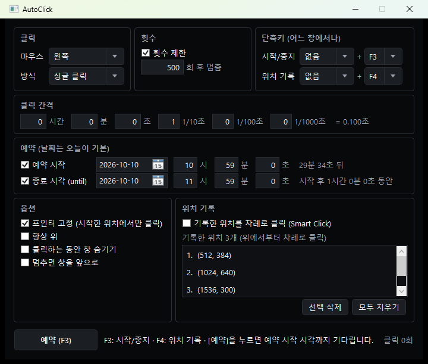
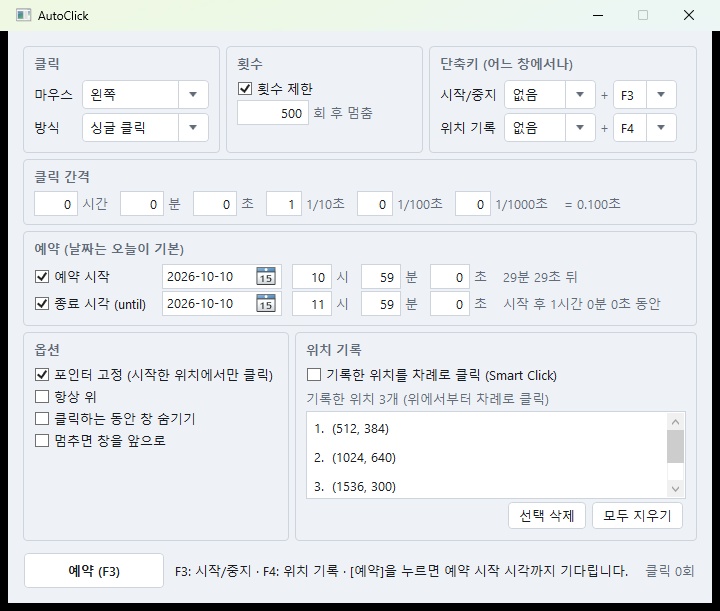
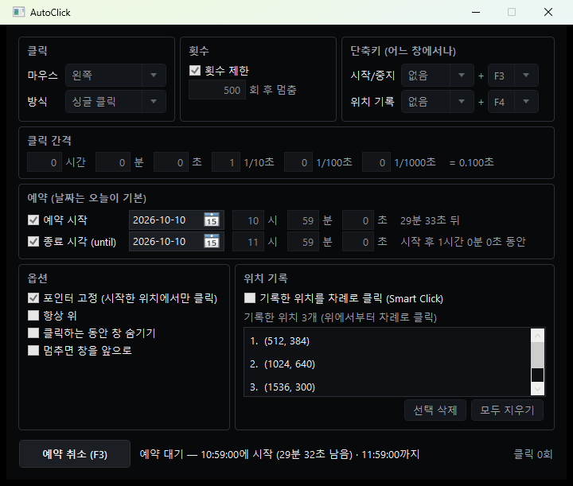

# Folderss AutoClick 플러그인

[Folderss](https://github.com/zaruous/Folderss) 파일 관리자에서 쓰는 마우스 자동 클릭 플러그인입니다.
프리웨어 **AutoClick 2.1**(BestSoftwareCenter, 2008)의 기능을 Folderss 플러그인(WPF, .NET 8)으로 새로 구현했습니다. 원본 프로그램의 코드나 바이너리는 들어 있지 않습니다.

[FolderssPLuginTemplate](https://github.com/zaruous/FolderssPLuginTemplate)을 바탕으로 만들었습니다.



| 밝은 테마 | 예약 대기 중 |
|---|---|
|  |  |

- 색은 Folderss의 현재 테마를 따릅니다(위: Black, 아래 왼쪽: Light).
- 예약 대기 중에는 설정이 잠기고, 상태 줄에 시작까지 남은 시간이 나옵니다. 버튼은 [예약 취소]로 바뀝니다.

```
빌드 결과: src/AutoClick/bin/Debug/net8.0-windows/AutoClick.zip
├── plugin.json     ← id: zaruous.folderss-autoclick, 메뉴 이름: AutoClick
└── AutoClick.dll
```

---

## 기능

| 원본 AutoClick 2.1 | 이 플러그인 | 설명 |
|---|---|---|
| Mouse: Left / Right / Middle | 클릭 > 마우스 | 왼쪽·오른쪽·가운데 버튼 |
| Click: Single / Double | 클릭 > 방식 | 싱글·더블 클릭 |
| Counter | 횟수 제한 | 정한 횟수만큼 클릭하면 저절로 멈춤 |
| Auto Click Hotkey (기본 F3) | 단축키 > 시작/중지 | 수식 키(없음·Ctrl·Alt·Shift·Ctrl+Alt·Ctrl+Shift) + F1~F12 |
| Click Interval (시간 ~ 1/1000초) | 클릭 간격 | 시간·분·초·1/10·1/100·1/1000초. 기본 0.1초 |
| Freeze Pointer | 포인터 고정 | 시작할 때의 포인터 위치에서만 클릭. 클릭 중 마우스를 움직여도 그 위치로 되돌아감 |
| Keep on Top | 항상 위 | |
| Hide AutoClick | 클릭하는 동안 창 숨기기 | 멈추면 창이 다시 나타남 |
| Show AutoClick | 멈추면 창을 앞으로 | |
| Smart Click + Record Hotkey (기본 F4) | 위치 기록 | 기록 단축키로 위치를 모아 두고, 그 위치들을 위에서부터 차례로 돌아가며 클릭 |
| — | [시작] 버튼 | 누르면 3초 뒤에 시작(그동안 클릭할 곳으로 마우스를 옮김). 카운트다운 중 다시 누르면 취소 |
| — | 예약 시작 | 날짜(기본 오늘)와 시·분·초를 정하면 그 시각까지 기다렸다가 시작 |
| — | 종료 시각 (until) | 날짜(기본 오늘)와 시·분·초를 정하면 그 시각에 멈춤. 횟수 제한과 함께 쓰면 먼저 닿는 쪽에서 멈춤 |
| — | 클릭 수 표시, 기록 목록에서 선택 삭제 | |

설정은 창을 닫을 때 저장되고 다음에 열 때 그대로 복원됩니다(`%LOCALAPPDATA%\Folderss\plugin-data\zaruous.folderss-autoclick\settings.json`).
예약의 날짜는 저장하지 않고 창을 열 때마다 오늘로 돌아갑니다. 시·분·초와 켜고 끈 상태는 저장됩니다.

---

## 사용법

1. Folderss에서 `⋯ 메뉴 > 플러그인 > AutoClick`을 엽니다.
2. 마우스 버튼·방식·간격을 정합니다.
3. 클릭할 곳에 마우스를 두고 **F3**을 누르면 시작하고, 다시 **F3**을 누르면 멈춥니다.

여러 곳을 번갈아 클릭하려면:

1. 클릭할 곳마다 마우스를 두고 **F4**를 눌러 위치를 기록합니다.
2. `기록한 위치를 차례로 클릭 (Smart Click)`을 켜고 **F3**으로 시작합니다.

정한 시각에 시작하거나 정한 시각까지만 클릭하려면:

1. `예약` 칸에서 `예약 시작`이나 `종료 시각 (until)`을 켜고 날짜와 시·분·초를 정합니다. 날짜는 오늘이 기본입니다. 줄 오른쪽에 지금부터 얼마 뒤인지(종료 시각은 시작 후 얼마 동안인지) 나옵니다.
2. `예약 시작`을 켰으면 버튼이 **[예약]** 으로 바뀝니다. [예약]이나 **F3**을 누르면 그 시각까지 기다렸다가 시작합니다. 버튼으로 눌러도 3초 카운트다운은 없습니다.
3. 기다리는 동안 상태 줄에 남은 시간이 나오고, [예약 취소]나 **F3**으로 취소합니다.
4. `종료 시각`만 켰으면 바로(버튼은 3초 뒤) 시작해서 종료 시각에 멈춥니다. 종료 시각 이후로는 클릭하지 않습니다.

- 예약 시각이 되면 **그때 포인터가 있는 곳**을 클릭합니다(포인터 고정이면 그 위치에 고정). 위치 기록 클릭을 켰으면 기록한 위치를 클릭합니다.
- 지난 시각, 시작보다 앞선 종료 시각은 시작할 때 거부하고 이유를 상태 줄에 보입니다.
- 예약 대기도 창이 열려 있는 동안만 유지됩니다. 창을 닫으면 예약도 취소됩니다. `클릭하는 동안 창 숨기기`를 켰으면 기다리는 동안은 창이 보이고, 클릭을 시작할 때 숨겨집니다.
- 컴퓨터가 절전 상태였다가 깨어나면 그때 시각으로 판단합니다. 시작 시각이 지났으면 바로 시작하고, 종료 시각도 지났으면 클릭하지 않고 멈춥니다.

### 알아 둘 점

- **단축키는 AutoClick 창이 열려 있는 동안만 동작합니다.** 창을 닫으면 클릭도 멈추고 단축키도 해제됩니다. 창을 숨긴 상태(클릭하는 동안 창 숨기기)에서도 단축키는 동작합니다.
- 단축키는 다른 프로그램보다 먼저 가로챕니다. 예를 들어 창이 열려 있는 동안에는 다른 프로그램에서 F3을 눌러도 AutoClick이 받습니다.
- 다른 프로그램이 이미 쓰는 단축키는 등록할 수 없고, 상태 줄에 이유가 나옵니다. 단축키를 등록하지 못했을 때는 창을 다시 불러올 방법이 없으므로 `클릭하는 동안 창 숨기기`가 켜져 있어도 창을 숨기지 않습니다.
- AutoClick 창은 하나만 열립니다. 이미 열려 있을 때 메뉴에서 다시 실행하면 기존 창이 앞으로 옵니다.
- **관리자 권한으로 실행한 프로그램**에는 클릭이 전달되지 않습니다(Windows의 UIPI 제한). Folderss도 관리자 권한으로 실행해야 합니다.
- 짧은 간격으로 같은 곳을 싱글 클릭하면, 받는 프로그램이 이를 더블 클릭으로 받아들일 수 있습니다(Windows 더블 클릭 시간 안에 두 번 눌리기 때문). 원본도 같습니다.
- 팝업 창은 Folderss 메인 창에 딸린 창이라, 메인 창을 최소화하면 함께 사라집니다.

---

## 빌드와 등록

요구 사항: Windows 10/11, [.NET 8 SDK](https://dotnet.microsoft.com/download/dotnet/8.0), 플러그인 기능이 있는 Folderss(계약 1.0.0).

```powershell
dotnet build
```

1. Folderss에서 `⋯ 메뉴 > 설정 > 플러그인 > 플러그인 찾기…`를 누르고 `src/AutoClick/bin/Debug/net8.0-windows/AutoClick.zip`을 고릅니다.
2. `⋯ 메뉴 > 플러그인 > AutoClick`을 누릅니다.

코드를 고친 뒤에는 다시 빌드하고, 같은 zip을 다시 등록한 다음 **Folderss를 재시작**합니다(한 번 로드한 플러그인 DLL은 종료할 때까지 내릴 수 없음).

---

## 폴더 구조

```
.
├── FolderssAutoClick.sln
├── .github/workflows/build.yml      ← main 푸시·PR 빌드, v* 태그에 GitHub 릴리스
├── docs/screenshot/                 ← README 스크린샷
├── src/AutoClick/
│   ├── AutoClick.csproj             ← 빌드하면 zip까지 만든다 (PackPlugin 타깃)
│   ├── plugin.json
│   ├── AutoClickPlugin.cs           ← 진입점 (IFolderssPlugin). 창을 하나만 연다
│   ├── AutoClickView.cs             ← 화면, 시작·중지·예약, 위치 기록, 창 크기 맞춤
│   ├── ClickRunner.cs               ← 백그라운드 스레드에서 예약 대기·클릭 반복·종료 시각
│   ├── Hotkeys.cs                   ← 단축키 값, 전역 단축키 등록(RegisterHotKey)
│   ├── AutoClickSettings.cs         ← 설정 읽기·저장
│   └── NativeMethods.cs             ← SendInput, Get/SetCursorPos, timeBeginPeriod
└── contract/Folderss.PluginContract/ ← Folderss 계약(인터페이스) 사본. 컴파일용이며 zip에 넣지 않음
```

### 구현 메모

| 항목 | 내용 |
|---|---|
| 클릭 | `SendInput`으로 누름·뗌을 보낸다. 위치를 옮길 때는 `SetCursorPos`. 좌표는 같은 프로세스의 DPI 기준이라 기록한 좌표를 그대로 되돌릴 수 있다 |
| 간격 | 백그라운드 스레드에서 `WaitHandle.WaitOne(간격)`. 실행 중에는 `timeBeginPeriod(1)`로 타이머 해상도를 1ms로 올린다 |
| 예약 | 시작 시각 대기도 같은 스레드에서 한다. 최대 1초씩 자면서 매번 남은 시간을 다시 계산하고(시계가 바뀌어도 맞춤), 타이머 해상도는 마지막 2초에만 올린다(긴 대기 동안 전력을 아낌). 종료 시각이 간격보다 먼저 오면 간격 대신 그 시각까지만 잔다 |
| 예외 | 클릭 스레드의 예외는 모두 잡아서 상태 줄에 보인다(플러그인 스레드에서 예외가 빠져나가면 Folderss가 종료됨) |
| 단축키 | 팝업 창 핸들에 `RegisterHotKey`(MOD_NOREPEAT). 창의 `Closed`에서 해제 |
| 창 크기 | 본체는 900×600 창을 만든다. 화면이 열리면 `SizeToContent`로 내용 크기에 맞추고, 본체가 잡은 가운데 위치를 유지한다 |
| 테마 | 색은 Folderss 테마 리소스 키(`BorderBrush`, `SecondaryText` 등)에 연결 |

### 설정 키

`mouseButton`(Left/Right/Middle), `doubleClick`, `intervalMs`, `counter.enabled`, `counter.limit`, `freezePointer`, `keepOnTop`, `hideWhileClicking`, `showOnStop`, `smartClick`, `smartClick.points`(`x,y;x,y`), `hotkey.start`·`hotkey.record`(예: `Ctrl+Alt+F3`, `F3`), `schedule.start.enabled`, `schedule.start.time`, `schedule.until.enabled`, `schedule.until.time`(`HH:mm:ss`, 날짜는 저장하지 않음).

---

## 릴리스 (GitHub Actions)

| 언제 | 하는 일 |
|---|---|
| `main` 푸시, PR | 빌드하고 플러그인 zip을 Actions의 **Artifacts**에 올린다 |
| `v*` 태그 푸시 | `plugin.json`의 `version`과 태그가 같은지 확인한 뒤 GitHub 릴리스를 만들고 `zaruous.folderss-autoclick-<version>.zip`을 첨부한다 |

```powershell
# plugin.json의 "version"을 올리고 커밋·푸시한 뒤
git tag v1.0.0
git push origin v1.0.0
```

---

## 계약 사본 관리

`contract/Folderss.PluginContract/PluginContracts.cs`는 Folderss 저장소 [`Folderss.PluginContract/PluginContracts.cs`](https://github.com/zaruous/Folderss/blob/master/Folderss.PluginContract/PluginContracts.cs)의 사본입니다. 어셈블리 이름·네임스페이스·형식 이름은 바꾸지 말고, Folderss가 계약을 갱신하면 원본으로 교체하세요. 자세한 내용은 [플러그인 템플릿 README](https://github.com/zaruous/FolderssPLuginTemplate#계약-사본-관리)를 보세요.

---

## 라이선스

[MIT](LICENSE)
